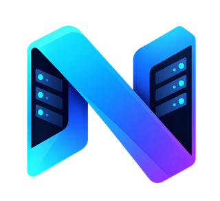

# Nexora Lab

A self-hosted infrastructure operations dashboard for a homelab: live host metrics, Proxmox guests, Docker workloads, network topology, alerts, and administrator controls. [Nexora Agent](https://github.com/johnvexcoder/nexora-agent) collects telemetry on each monitored Linux host.

**Release status:** release candidate work; clean-host installation, container permissions, HTTPS, upgrade, and disaster recovery still require the acceptance run in [RELEASE-CHECKLIST.md](RELEASE-CHECKLIST.md). Passing unit tests does not certify a production deployment.

## Start here

- [Production installation, pairing, backup, restore, and recovery](PRODUCTION.md)
- [Development setup and architecture](SETUP.md)
- [Release acceptance checklist](RELEASE-CHECKLIST.md) · [Release candidate evidence](RELEASE-CANDIDATE.md)
- [Core–Agent protocol](PROTOCOL.md) · [GPL-3.0-or-later license](LICENSE)

[Nexora Lab](https://github.com/johnvexcoder/nexora-lab) and [Nexora Agent](https://github.com/johnvexcoder/nexora-agent) are independent repositories. Build the reviewed release locally; no prepublished container image is assumed.

## What it does

- React dashboard with real-time WebSocket updates, history charts, alerts and topology.
- Agent telemetry, plus optional direct Proxmox API integration.
- Local administrator bootstrap, role-based permissions, sessions, TOTP and recovery tools.
- SQLite persistence, online database backups, configuration snapshots, and offline recovery CLI.
- Optional SMTP and notification integrations configured through the administrator UI.

Use a trusted management LAN or an HTTPS reverse proxy. Nexora Lab is a single-host application, not a high-availability control plane. Telemetry requires compatible host tools and permissions; the default Agent intentionally cannot access the Docker daemon or raw disks.

## Nexora Lab ↔ Nexora Agent integration

The two repositories communicate over one versioned HTTP contract:

- **[Nexora Lab](https://github.com/johnvexcoder/nexora-lab)** — the dashboard, backend, telemetry engine and Proxmox/Docker integrations.
- **[Nexora Agent](https://github.com/johnvexcoder/nexora-agent)** — an independent, outbound-only telemetry agent installed on each monitored Linux host.

Relationship and compatibility:

- **Outbound-only.** The Agent never opens inbound ports. It authenticates to this Core with an `X-Agent-Key` header (a `hl_…` key stored only as a SHA-256 hash) and calls exactly three endpoints under `/api/agent/`: `register`, `report`, `events`.
- **Versioned, backward-compatible protocol.** v0 is the implicit default format the Agent ships with; an opt-in v1 envelope is signalled by the `X-Protocol-Version` header and unwrapped by this Core's adapter, routing through the same handlers. This Core accepts both during migration and logs a one-time deprecation warning for v0 messages. The contract lives in the Nexora workspace at `docs/CORE-AGENT-PROTOCOL.md` and in the Agent's `docs/PROTOCOL.md`.
- **Capability-based.** The Agent advertises only the capabilities a host actually supports; this Core merges agent deltas with optional direct Proxmox data into a unified model the frontend consumes, without knowing plugin internals.

Setup:

1. In the dashboard, create the agent under **Settings → Agents** and save the one-time `hl_…` API key.
2. On each monitored host, install the Agent pointing at this Core: `sudo ./install.sh --dashboard-url https://DASHBOARD_HOST/api --api-key-file /secure/path/agent-api-key`.
3. The host appears online within ~10–15 seconds. Use the Agent's `--diagnose` mode for connection/version/capability troubleshooting.

The approved Nexora Lab logos are included unchanged: the compact mark appears in navigation and browser placements, and the detailed mark in larger branding. Persisted names such as `homelab.db` and the existing `Nexora` authenticator issuer remain unchanged so upgrades preserve data and enrolled TOTP accounts.
